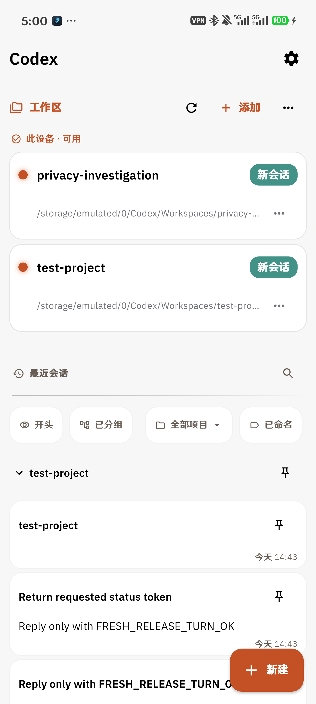
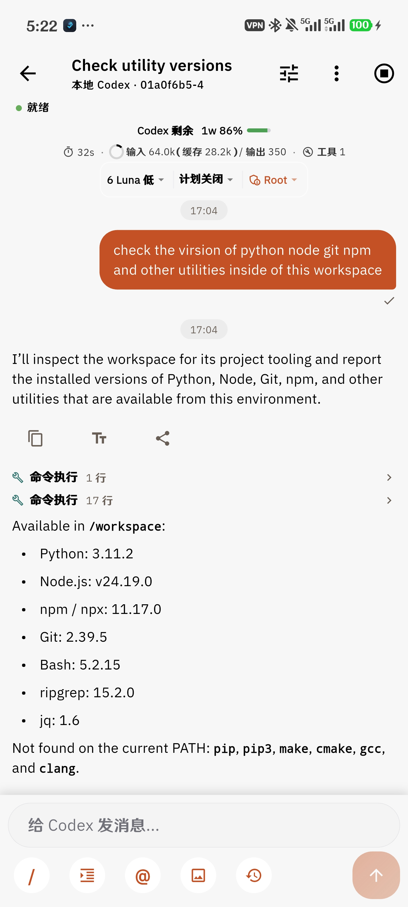

# Android Codex

Android Codex 是一个独立、本地优先的 Android Codex 客户端，目标是让用户直接在 Root Android 设备上用自然语言完成原本繁琐的系统 tinkering：替换字体、修改应用配置、安装依赖、检查系统和维护本地 workspace。

本项目不是 CC Pocket 的附属仓库。它复用了 CC Pocket 中已经验证过的 Flutter UI 组件和 session 交互，但应用身份、运行时、Android 集成、发布流程和 Git 仓库均独立。项目不依赖 PC Bridge、远程机器、WebSocket 中转或 Claude Code。

## 功能概览

- 本地 workspace 与多 session 管理。
- 每个 session 独立保存历史、草稿、运行状态和 Codex thread。
- 流式 assistant 输出、tool call、计划、审批、diff 和用量展示。
- OpenAI 登录与 OpenAI-compatible 第三方 provider 配置。
- 模型、推理档位、计划模式、权限模式和语言/主题设置。
- Root-first Android 执行环境，支持 KernelSU、Linux/PRoot guest 和 Android 宿主工具。
- 在 PRoot guest 中使用官方 Linux ARM64 Codex CLI/app-server，以及 git、Node.js、npm、npx、Python 等常用工具。
- CLI/runtime 可独立替换，避免把 Flutter UI 锁死在单一 Codex CLI 版本。

## 实现路线

```text
Android Codex UI
        │
        ├── workspace / session / transcript / composer
        ├── settings / provider / model / usage
        │
        ▼
平台无关 Codex client
        │
        ├── app-server JSON-RPC
        ├── thread / turn 生命周期
        ├── 流式事件与历史恢复
        └── provider/auth 配置
        │
        ▼
Android local runtime
        │
        ├── KernelSU Root：常态执行身份
        ├── Linux ARM64 PRoot：兼容 Linux CLI 和依赖
        ├── Android host：文件、进程和系统集成
        └── 高风险 boot 目标：验证、软路由和明确授权
```

运行时设计遵循 Root-first，但不把普通操作拆成逐条 broker 审批。普通文件读取、workspace 操作和常规命令优先直接工作；可能导致设备不可启动的 boot、raw block 和启动链修改通过行为规范、目标验证和明确授权保护。详细边界见 [PROJECT_DIRECTION.md](docs/android-local-codex/PROJECT_DIRECTION.md) 和 [ROOT_ACCESS_POLICY.md](docs/android-local-codex/ROOT_ACCESS_POLICY.md)。

## UI 与交互

界面以 CC Pocket 的信息架构为基础进行 Android Codex 适配：

- 首页按 workspace 展示项目，并在 workspace 下展开最近 session。
- session 切换不会因为离开页面而主动停止后台 turn。
- thread 页面保留 composer、模型/推理选择、计划状态、权限模式、实时输出和用量信息。
- 设置页面承载登录、provider、runtime、KernelSU、主题、语言和更新配置。
- UI 组件源码位于 [packages/ccpocket_ui](packages/ccpocket_ui)，应用逻辑位于 [apps/codex](apps/codex)。

### 真机效果

以下截图来自 Android ARM64 真机 `6cb21282` 的 Release 应用。使用固定宽度双栏展示，避免原始手机截图纵向铺满 README：

<table>
  <tr>
    <td align="center"></td>
    <td align="center"></td>
  </tr>
  <tr>
    <td align="center">workspace / session 首页</td>
    <td align="center">真实 thread、用量、Root、工具执行与结果</td>
  </tr>
</table>

截图仅用于展示真实布局和能力，不包含 API key、access token、keystore 或设备认证信息；它们不是静态 mock 页面。

## 构建

项目使用 Flutter 3.47.0、Android Gradle Plugin 和 Kotlin Android 构建 Android ARM64 APK。中文路径下，构建脚本会临时使用 ASCII junction，避免 Flutter Windows 工具链处理中文路径时出现 depfile/AOT 问题。

```powershell
pwsh -File tools/build-android.ps1 -Mode release
```

如果没有正式 keystore，Release 会使用 debug certificate，仅适合本地 QA。正式构建需要通过进程环境变量提供：

```text
CODEX_RELEASE_STORE_FILE
CODEX_RELEASE_STORE_PASSWORD
CODEX_RELEASE_KEY_ALIAS
CODEX_RELEASE_KEY_PASSWORD
```

然后使用：

```powershell
pwsh -File tools/build-android.ps1 -Mode release -RequireReleaseSigning
```

正式 keystore、密码、`local.properties`、API key 和设备数据不能提交到 Git。构建后执行：

```powershell
pwsh -File tools/verify-android-apk.ps1 `
  -ApkPath apps/codex/build/app/outputs/flutter-apk/app-release.apk `
  -RequireReleaseSigning `
  -RequireCodexNativeAssets
```

## 测试与验收

```powershell
Set-Location apps/codex
C:\toolchains\flutter-3.47.0\bin\flutter.bat test --no-pub
```

最近一次完整 Flutter 回归为 `379/379`。Release verifier 已验证：

- package：`io.henry.codex`
- version：`1.0.0`，versionCode `1`
- Release certificate 签名有效
- APK non-debuggable
- 四个 ARM64 PRoot/host runtime 资产齐全
- 无旧 Bridge/Bionic Codex 资产

公开发布前仍应在目标设备上复核真实 Root、长时间并行 session、provider 切换和 CLI 更新；Flutter 测试不能替代这些设备数据面验收。

## 发布

当前公开版本说明见 [Release 1.0.0](docs/release/RELEASE_1.0.md)。正式 APK 发布时应同时提供 APK、SHA-256、package/version 信息、签名证书指纹、Android ARM64/KernelSU/PRoot 要求和已知限制说明。

仓库远端：

<https://github.com/Henryma22/Android_native_codex>

## 安全扫描

提交或发布前运行：

```powershell
pwsh -File tools/secret-scan.ps1
```

扫描会排除构建缓存和本地验收产物，并检查常见 API key、token、私钥和明文凭据模式。它不能替代人工审查，也不会读取或上传 keystore。

## 目录结构

- `apps/codex`：Flutter Android 应用与本地 session/client。
- `packages/ccpocket_ui`：复用并适配的 CC Pocket UI 组件。
- `tools/android-local-runtime`：Android host、PRoot、rootfs 与 runtime 脚本。
- `tools`：构建、APK 验证和 secret scan。
- `docs/android-local-codex`：路线、Root 规范、验收和缺陷记录。
- `docs/release`：发布说明与截图。

## License

见 [LICENSE](LICENSE)。CC Pocket UI 组件的来源和适配边界以其源文件许可与项目文档为准。
